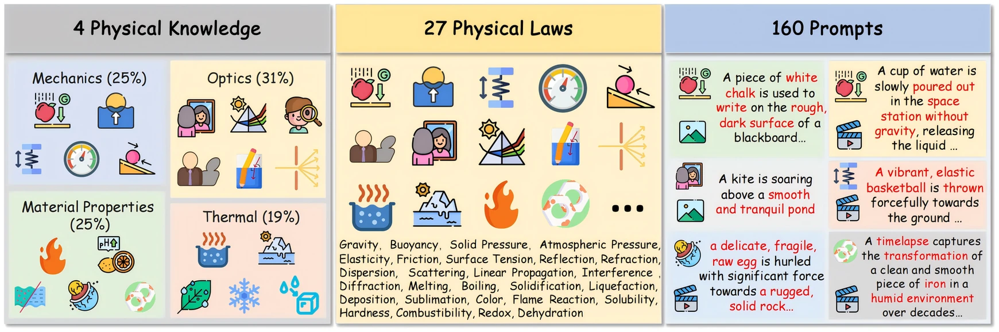
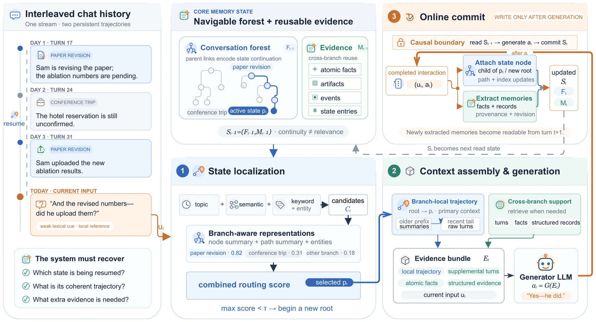
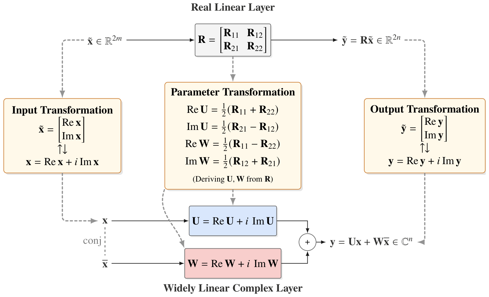

<!-- Snake Code Contribution Map 贪吃蛇代码贡献图 -->
<picture>
  <source media="(prefers-color-scheme: dark)" srcset="https://raw.githubusercontent.com/12345txy/12345txy/output/github-contribution-grid-snake-dark.svg" />
  
</picture>

## 👋 About Me

<picture>
  <source media="(prefers-color-scheme: dark)" srcset="https://github-profile-summary-cards.vercel.app/api/cards/profile-details?username=12345txy&theme=github_dark" />
  
</picture>

##  Publications

### Conference Papers

<table class="publication-list" role="presentation">
  <tr>
    <td class="publication-art" width="272" valign="middle">
      
    </td>
    <td class="publication-details" valign="middle">
      
<strong><a href="https://arxiv.org/abs/2410.05363">Towards world simulator: Crafting physical commonsense-based benchmark for video generation</a></strong>

      
Fanqing Meng, Jiaqi Liao, Xinyu Tan, Quanfeng Lu, Wenqi Shao, Kaipeng Zhang, Yu Cheng, Dianqi Li, Ping Luo <em>International Conference on Machine Learning (<strong>ICML</strong>), 2025 (Poster)</em>

      

        <a href="https://arxiv.org/abs/2410.05363">arXiv</a>
        <a href="https://phygenbench123.github.io/">Project page</a>
        <a href="https://scholar.google.com/citations?view_op=view_citation&amp;hl=en&amp;user=gGm2-SwAAAAJ&amp;citation_for_view=gGm2-SwAAAAJ:u5HHmVD_uO8C">Citations (213)</a>
      

    </td>
  </tr>
</table>

### Preprints

<table class="publication-list" role="presentation">
  <tr>
    <td class="publication-art" width="272" valign="middle">
      
    </td>
    <td class="publication-details" valign="middle">
      
<strong><a href="https://arxiv.org/abs/2605.27922">Harness-Bench: Evaluating Agent Harnesses across Models and Realistic Workflows</a></strong>

      

        Yilun Yao*, Xinyu Tan*,
        Chao-Hsuan Liu*, Yaoming Li*, et al. 
        <em>arXiv preprint, 2026</em> · * Equal contribution
      

      

        <a href="https://arxiv.org/abs/2605.27922">arXiv</a>
        <a href="https://scholar.google.com/citations?view_op=view_citation&amp;hl=en&amp;user=gGm2-SwAAAAJ&amp;citation_for_view=gGm2-SwAAAAJ:9yKSN-GCB0IC">Citations (67)</a>
      

    </td>
  </tr>
  <tr>
    <td class="publication-art" width="272" valign="middle">
      
    </td>
    <td class="publication-details" valign="middle">
      
<strong><a href="https://arxiv.org/abs/2608.17534">ArborMem: Navigating Interaction States with Memory Forests</a></strong>

      
Zongwei Lv, Yuemeng Xu, Yilun Yao, Siyi Ding, Xinyu Tan, et al. <em>arXiv preprint, 2026</em>

      

        <a href="https://arxiv.org/abs/2608.17534">arXiv</a>
        <a href="https://scholar.google.com/citations?view_op=view_citation&amp;hl=en&amp;user=gGm2-SwAAAAJ&amp;citation_for_view=gGm2-SwAAAAJ:2osOgNQ5qMEC">Citations (0)</a>
      

    </td>
  </tr>
  <tr>
    <td class="publication-art" width="272" valign="middle">
      
    </td>
    <td class="publication-details" valign="middle">
      
<strong><a href="https://arxiv.org/abs/2512.02901">Fairy2i: Training Complex LLMs from Real LLMs with All Parameters in {±1, ±i}</a></strong>

      
Feiyu Wang, Xinyu Tan, Bokai Huang, et al. <em>arXiv preprint, 2025</em>

      

        <a href="https://arxiv.org/abs/2512.02901">arXiv</a>
        <a href="https://github.com/PKULab1806/Fairy2i-W2">Code</a>
        <a href="https://huggingface.co/PKU-DS-LAB/Fairy2i-W2">Model</a>
        <a href="https://scholar.google.com/citations?view_op=view_citation&amp;hl=en&amp;user=gGm2-SwAAAAJ&amp;citation_for_view=gGm2-SwAAAAJ:d1gkVwhDpl0C">Citations (0)</a>
      

    </td>
  </tr>
</table>

##  Tech Stack

<table>
  <tr>
    <td align="center" width="140"><b>编程语言</b></td>
    <td>
      <picture>
        <source media="(prefers-color-scheme: dark)" srcset="./img/skills/lang-dark.svg" />
        
      </picture>
    </td>
  </tr>
  <tr>
    <td align="center" width="140"><b>AI / 数据科学</b></td>
    <td>
      <picture>
        <source media="(prefers-color-scheme: dark)" srcset="./img/skills/ai-dark.svg" />
        
      </picture>
    </td>
  </tr>
  <tr>
    <td align="center" width="140"><b>Web 前后端</b></td>
    <td>
      <picture>
        <source media="(prefers-color-scheme: dark)" srcset="./img/skills/web-dark.svg" />
        
      </picture>
    </td>
  </tr>
  <tr>
    <td align="center" width="140"><b>工具链</b></td>
    <td>
      <picture>
        <source media="(prefers-color-scheme: dark)" srcset="./img/skills/tools-dark.svg" />
        
      </picture>
    </td>
  </tr>
</table>

   
  

##  GitHub Stats

<picture>
  <source media="(prefers-color-scheme: dark)" srcset="https://github-readme-stats-blue-eight-47.vercel.app/api?username=12345txy&show_icons=true&include_all_commits=true&hide_title=true&line_height=24&hide_border=true&bg_color=00000000&theme=github_dark" />
  
</picture>
<picture>
  <source media="(prefers-color-scheme: dark)" srcset="https://github-readme-stats-blue-eight-47.vercel.app/api/top-langs/?username=12345txy&layout=compact&langs_count=6&hide_title=true&hide_border=true&bg_color=00000000&theme=github_dark" />
  
</picture>

<!--START_SECTION:waka-->
<!-- 如果 WakaTime 统计无法显示，请检查：
1. WakaTime 个人资料是否设置为公开：https://wakatime.com/settings/profile
2. 确认 WakaTime 用户名是否正确（可能与 GitHub 用户名不同）
3. 如需配置 API Key，在 Vercel 环境变量中添加 WAKATIME_API_KEY -->
<picture>
  <source media="(prefers-color-scheme: dark)" srcset="https://github-readme-stats-blue-eight-47.vercel.app/api/wakatime?username=12345txy&layout=compact&langs_count=8&custom_title=WakaTime%20Coding%20Time&hide_border=true&bg_color=00000000&theme=github_dark" />
  
</picture>
<!--END_SECTION:waka-->

